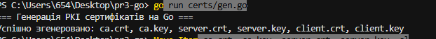
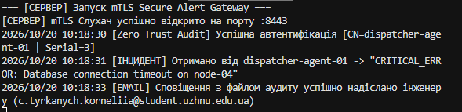
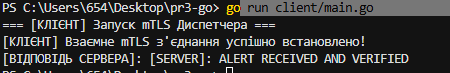

# Пр3

**Виконала:** Тирканич Корнелія з групи КН-41

## Тема роботи

Практична робота з мови програмування Go, у якій реалізовано шлюз критичних сповіщень та аудиту (**Secure Alert Gateway**) з використанням взаємної автентифікації **mTLS (Zero Trust)** та автоматичною відправкою поштових повідомлень формату **MIME** через **SMTP**.

## Мета роботи

Отримати практичні навички створення захищених мережевих сервісів мовою Go, генерації криптографічних сертифікатів, налаштування взаємної TLS-автентифікації, аудиту підключених пристроїв та автоматичного надсилання електронних сповіщень із вкладеннями.

## Особливості та реалізація

Проєкт розділено на три рівні складності.

### Рівень 1. Базовий — генерація PKI та захищений mTLS-шлюз

- **Генерація криптографічних сертифікатів.** Реалізовано Go-скрипт `certs/gen.go` для автоматичного створення ключів і сертифікатів стандарту X.509 за допомогою пакета `crypto/x509`.
- **Інфраструктура PKI.** Створено файли `ca.crt`, `ca.key`, `server.crt`, `server.key`, `client.crt` та `client.key`.
- **Захищений TCP-сервер.** Налаштовано TLS-слухач на порту `8443` із використанням `tls.Listen`.
- **Взаємна автентифікація mTLS.** Реалізовано обов'язкову перевірку клієнтського сертифіката за допомогою `tls.RequireAndVerifyClientCert`.
- **Захищений клієнт.** Реалізовано підключення авторизованого клієнта через `tls.Dial`.

### Рівень 2. Ключовий — автоматичне надсилання email через SMTP

- **Поштовий модуль.** Створено окремий сервіс `email/email.go` на основі пакета `net/smtp`.
- **SMTP-авторизація.** Реалізовано автентифікацію за допомогою `smtp.PlainAuth`.
- **Підтримка захищених з'єднань.** Передбачено роботу з портами `587` (STARTTLS) та `465` (SSL/TLS).
- **Автоматичне сповіщення.** Після успішного встановлення mTLS-з'єднання та приймання тривоги сервер формує й надсилає електронний лист черговому інженеру.

### Рівень 3. Просунутий — аудит Zero Trust та MIME-вкладення

- **Аудит ідентичності пристрою.** За допомогою `conn.(*tls.Conn).ConnectionState()` отримуються дані про TLS-з'єднання та сертифікат автентифікованого клієнта.
- **Ідентифікація клієнта.** Зчитуються `Subject.CommonName` та `SerialNumber` із сертифіката клієнта.
- **Багатокомпонентний MIME-лист.** Реалізовано формування електронного повідомлення з використанням розділювача `boundary`.
- **HTML-повідомлення.** Тіло листа містить оформлену таблицю з параметрами тривоги та індикатором аварії.
- **Технічний звіт.** Автоматично генерується файл `incident_report.log`, який додається до листа.
- **Кодування вкладення.** Звіт кодується за допомогою Base64 із використанням пакета `encoding/base64`.

## Використані технології

| Технологія | Призначення |
|---|---|
| Go | Реалізація мережевого сервісу |
| `crypto/x509` | Генерація сертифікатів X.509 |
| `crypto/tls` | Захищені TLS-з'єднання та mTLS |
| `net` | TCP-з'єднання |
| `net/smtp` | Відправлення електронної пошти |
| `mime/multipart` | Формування багатокомпонентних MIME-повідомлень |
| `encoding/base64` | Кодування вкладених файлів |
| SMTP | Передавання електронних повідомлень |
| PKI | Інфраструктура відкритих ключів |
| Zero Trust | Перевірка ідентичності клієнта |

## Очікувана структура проєкту

```text
Пр3/
├── certs/
│   └── gen.go
├── email/
│   └── email.go
├── main.go
├── go.mod
└── README.md
```

*Структура наведена як приклад. Фактичний склад файлів може відрізнятися залежно від реалізації проєкту.*

## Безпека

- Сервер перевіряє сертифікат клієнта перед обробкою тривоги.
- Ідентичність підключеного пристрою використовується для аудиту.
- Для надсилання повідомлень передбачено SMTP-авторизацію та захищене з'єднання.
- Приватні ключі й облікові дані поштового сервера не слід публікувати у відкритому репозиторії GitHub.

## Висновок

У ході виконання практичної роботи було реалізовано три рівні завдання: генерацію криптографічних сертифікатів, захищений мережевий шлюз із взаємною автентифікацією mTLS та автоматичне надсилання електронних сповіщень через SMTP. Також опановано принципи PKI, аудиту Zero Trust і формування MIME-повідомлень із HTML-вмістом та вкладеними файлами. Отримані знання допомагають краще зрозуміти побудову захищених мережевих сервісів мовою Go.

## результат

### 1 рівень

### 2 рівень

### 3 рівень
